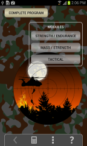
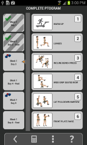
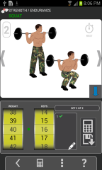

# CommandoFit - 2010

An Android fitness app that I developed around 2013 and published on Google Play.

> **Status:** Legacy project. The code is provided **as is**, mainly for reference and archival purposes. Updates and more information may follow.

## Overview

CommandoFit helps users plan, run, and track workouts. Based on the in-app help content, the app includes:

- Workout programs in several categories: **tactical**, **cardio**, **endurance**, and **mass**
- Workout lists and individual workout screens
- A workout **log calendar** for tracking completed sessions
- A **one-rep max** calculator
- A **heart rate** reference
- Configurable **settings**
- Built-in help pages that describe each screen

<!-- TODO: Adjust this list to match the features of the released app. -->

## Screenshots
<br />
<br />
<br />
<br />

## Project structure

This is a multi-module Gradle project, originally created in Eclipse (ADT) and later imported into Gradle.

| Module | Description |
| --- | --- |
| `olmatechFit` | The main application module (UI, workout logic, help pages in `src/main/resources`) |
| `licensingCommon` | Shared licensing code |
| `loaderEx` | [CWAC LoaderEx](https://github.com/commonsguy/cwac-loaderex) by CommonsWare, loaders for SQLite and `SharedPreferences` |
| `wheel` | Wheel-style picker UI component |

Other notable files:

- `import-summary.txt`: the report generated by the Eclipse-to-Gradle import
- `build.gradle`, `settings.gradle`, `gradlew`, `gradlew.bat`: Gradle build configuration and wrapper

## Tech stack

- Java, Android SDK
- Gradle (imported from an Eclipse ADT project)
- Android Support Library v4 (`com.android.support:support-v4:18.0.0`)
- Facebook SDK 4.0.0 (source included in the `olmatechFit` module)

## Building

Because this project dates from the early Android Gradle era, it may need updates to build with current tooling.

1. Clone the repository:
   ```bash
   git clone https://github.com/olgab99/CommandoFit.git
   cd CommandoFit
   ```
2. Open the project in Android Studio, or build from the command line:
   ```bash
   # Windows
   gradlew.bat assembleDebug

   # macOS / Linux
   ./gradlew assembleDebug
   ```
3. Gradle needs network access to download dependencies.

**Known caveats:**

- The Gradle wrapper, Android Gradle Plugin, and `compileSdkVersion` are old and will likely need upgrading for current Android Studio releases.
- The legacy Support Library (`support-v4`) should be migrated to AndroidX.
- The Facebook SDK sources bundled in the app module should be replaced with the current official SDK dependency.

## Contributing

This is an archived personal project, and it is not actively maintained. Feel free to fork it for your own use.

## License

No license is specified yet. <!-- TODO: add a LICENSE file, e.g. MIT or Apache 2.0. -->

Third-party components keep their own licenses, including CWAC LoaderEx and the Facebook SDK.

## Author

Created by [olgab99](https://github.com/olgab99).
